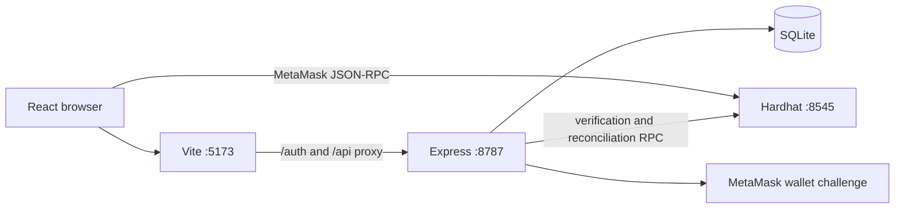

# EventRent

EventRent is a local MVP for equipment-rental requests with a Solidity security-deposit escrow. It combines a React/Vite frontend, an Express/TypeScript backend, SQLite application state, and a local Hardhat blockchain.

The MVP intentionally separates:

- **SQLite state:** users, sessions, persisted renter/owner capabilities, listings, booking requests, and verified transaction metadata.
- **Blockchain state:** rental parties, rental dates, deposit custody, lifecycle status, disputes, and claimable balances.
- **Browser state:** navigation, form values, wallet connection, and cached API responses.

The blockchain does not prove equipment condition, physical pickup, physical return, identity, or who is truthful in a dispute.

## Prerequisites

- Node.js 24.x and npm 11.x are the versions currently validated in this workspace.
- MetaMask or another injected wallet provider is needed for manual wallet and escrow demonstrations.
- No public RPC, faucet, paid provider, or real email account is needed for the local MVP.

Install dependencies:

```powershell
npm install
npm install --prefix frontend
```

## Local startup

Use separate PowerShell terminals.

### 1. Start Hardhat

```powershell
npx hardhat node
```

### 2. Deploy the local escrow

Deployment is opt-in and never overwrites a configured address. Set the flag for
an intentional first deployment:

```powershell
$env:RENTAL_ESCROW_DEPLOY="1"
npx hardhat run scripts/deploy.ts --network localhost
```

The script prints the chain, arbitrator, and new address. Copy that printed
address into both backend and frontend configuration; the script does not edit
either file. If `RENTAL_ESCROW_ADDRESS` already points to bytecode on the
connected chain, the script reports it and exits without deploying. If the
configured address has no bytecode (for example, after a node restart), an
explicit deployment flag is required. Invalid, unreachable, wrong-chain, or
different-bytecode configurations always stop, and an existing configured
address is never overwritten automatically.

Before starting the app, inspect the configured deployment:

```powershell
npm run inspect:chain -- --json
```

The inspection reports the expected/connected chain IDs, checksummed address,
latest block, runtime bytecode presence and size, and the runtime bytecode hash
against the compiled `RentalEscrow` artifact. A status other than `OK` means the
backend/frontend should not be started with that address. To inspect a one-off
address without changing environment variables, use
`npm run inspect:chain -- --address=0x...`.

Copy the printed address into `frontend/.env.local`:

```text
VITE_RENTAL_ESCROW_ADDRESS=0x...
VITE_HARDHAT_CHAIN_ID=31337
```

Set the same address in the backend process:

```powershell
$env:NODE_ENV="development"
$env:RENTAL_ESCROW_ADDRESS="0x..."
$env:BLOCKCHAIN_RPC_URL="http://127.0.0.1:8545"
$env:BLOCKCHAIN_CHAIN_ID="31337"
$env:BLOCKCHAIN_CONFIRMATIONS="2"
$env:BLOCKCHAIN_RPC_TIMEOUT_MS="10000"
$env:APP_ORIGIN="http://localhost:5173"
npm run backend
```

The default SQLite database is `backend\eventrent-auth.sqlite`. Set `AUTH_DB_PATH` to use another local path.

### 3. Start the frontend

```powershell
npm run dev --prefix frontend
```

Open `http://localhost:5173`. Port `8787` is the backend API, not the website.

The backend uses wallet challenge authentication only; no SMTP or email account is needed.

## Tests and checks

```powershell
npm run typecheck:auth
npm run test:auth
npm run test:blockchain
npm run test:marketplace
npm run build --prefix frontend
npm test
```

The Solidity tests use an isolated Hardhat network. Backend tests use isolated databases and do not modify the live local database.

## Demonstration journey

1. Start Hardhat and deploy the contract.
2. Import two disposable Hardhat accounts into MetaMask. The frontend automatically adds or switches to chain `31337` when Connect MetaMask is clicked.
3. Start the wallet-auth backend and Vite.
4. Choose renter or owner, connect MetaMask, and approve the free wallet challenge signature.
5. Create an owner listing with a unique serial ID and upload a clear item image; the marketplace starts empty and has no sample catalogue.
6. Confirm the listing appears in the renter marketplace with its serial validation status and image.
7. Submit a future booking request as a different wallet.
8. Approve the request as the listing owner.
9. Create the rental through the owner wallet.
10. Confirm the backend accepts it only after independently checking the transaction, event, calldata, contract state, confirmations, and canonical block.
11. Fund the deposit as the renter.
12. Confirm pickup as the owner, mark return as the renter, then approve a refund or raise and resolve a dispute.
13. Reconcile the booking through `POST /api/bookings/:id/onchain/reconcile` after a later escrow action. The backend records the current contract status as a snapshot; the contract remains authoritative for custody.

Physical equipment checks and dispute evidence remain human/off-chain responsibilities.

## Architecture



The backend does not trust browser transaction status. `PATCH /api/bookings/:id/onchain` verifies the local-chain transaction before persisting the association. Reconciliation re-reads the rental and checks the original receipt remains canonical.

## Trust model and limitations

- Wallet authentication requires a server-generated, expiring, single-use signed challenge and creates an HttpOnly session cookie backed by a hashed session token.
- The selected renter/owner capability is persisted through an authenticated endpoint; backend capability checks and ownership queries protect listing and booking mutations.
- Contract calls enforce renter, owner, and arbitrator permissions independently.
- The rental fee is stored as contract metadata; `RentalEscrow` only escrows the security deposit.
- Local Hardhat state resets when the node restarts. Redeploy and update both contract-address settings.
- The current app has no background event indexer. Reconciliation is explicit and must be invoked after later lifecycle actions.
- Local deployment is explicit: `scripts/deploy.ts` refuses to deploy by default, never edits address configuration, and will not replace a configured contract. Run `npm run inspect:chain -- --json` after starting or restarting Hardhat to detect stale addresses before using the demo.
- RPC timeout handling is bounded, but the app is not a production-grade multi-node finality or reorganization service.
- Wallet-login and abuse throttles are in-memory and suitable for one local process, not a multi-instance deployment.

## Environment reference

See [`.env.example`](./.env.example), [`frontend/.env.example`](./frontend/.env.example), and [AUTHENTICATION.md](./AUTHENTICATION.md). Do not place secrets in frontend `VITE_*` variables.
