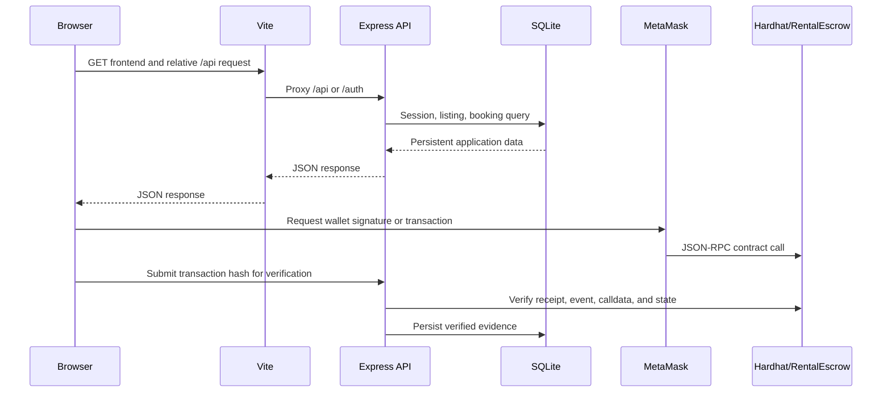
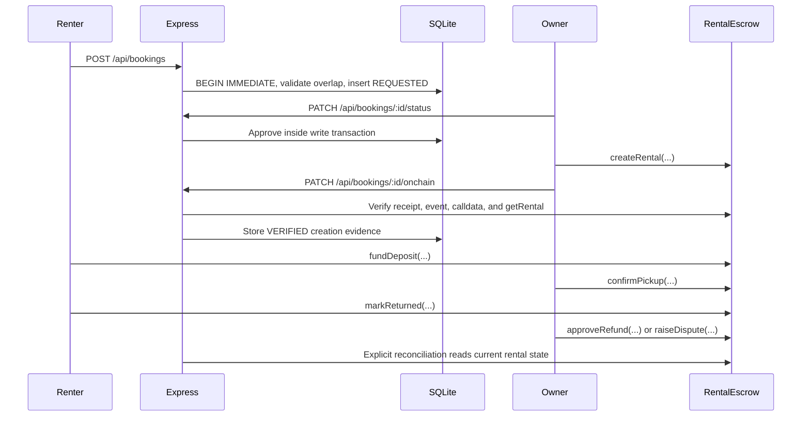
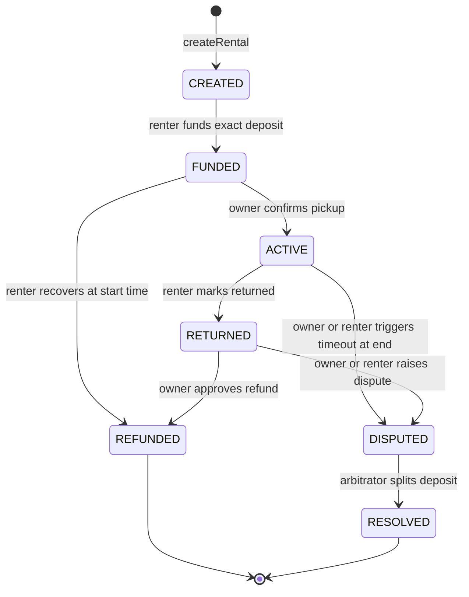

# EventRent Architecture Reference

## Runtime topology

## State authority

| Concern | Authority |
|---|---|
| User, session, email verification | SQLite plus backend auth code |
| Listing ownership and active flag | SQLite plus backend authorization |
| Booking request and owner decision | SQLite plus backend transactions |
| `createRental` evidence | Backend verification of the chain, then SQLite metadata |
| Deposit custody and escrow lifecycle | `RentalEscrow` on the configured chain |
| UI loading and navigation | React state only |

## Booking and escrow sequence

## Contract state machine

`withdraw` transfers an already-created claimable balance. It does not change rental status.

## API groups

- `/auth/register`, `/auth/login`, `/auth/session`, `/auth/logout`
- `/auth/verify-email`, `/auth/verify-email/resend`
- `/auth/password-reset/request`, `/auth/password-reset/confirm`
- `/auth/nonce`, `/auth/verify`
- `/api/listings`, `/api/listings/:id`, `/api/my/listings`
- `/api/bookings`, `/api/bookings/:id`
- `/api/bookings/:id/status`
- `/api/bookings/:id/onchain`
- `/api/bookings/:id/onchain/reconcile`

Protected routes use the server-side session cookie and perform object-level ownership checks. Client workspace selection is presentation state only.
